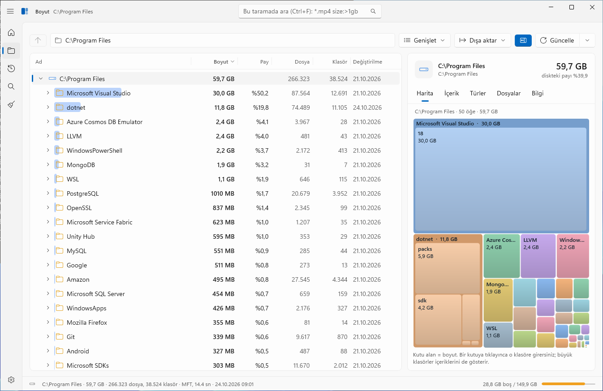

# Boyut

Windows 11 için klasör ve disk analizi. TreeSize / FolderSize / WizTree sınıfında. NTFS'te MFT'yi doğrudan okuduğu için hızlı, Windows 11 (Fluent 2) arayüzüyle modern.

**[Tanıtım sayfası](https://mihrimatrix.github.io/boyut/)** · **[İndir (Windows x64)](https://github.com/MihrimatriX/boyut/releases/latest/download/Boyut-win-x64.zip)**



## Gereksinimler

- Windows 10 2004 (19041) veya üstü. Mica efekti için Windows 11.
- [.NET 10 SDK](https://dotnet.microsoft.com/download/dotnet/10.0)
- Visual Studio 2022 17.14+ / 2026. Kullanılacak iş yükleri: **.NET masaüstü geliştirme** ve **Windows App SDK C# şablonları**. Bunun yerine yalnızca `dotnet` CLI de kullanılabilir.

## Derleme ve çalıştırma

```powershell
# Tümünü derle + testleri çalıştır
./build.ps1

# Uygulamayı çalıştır
./build.ps1 -Run

# Tek başına çalışan klasör (Windows App SDK ve .NET dahil)
./build.ps1 -Publish      # → artifacts\Boyut\Boyut.exe
```

Visual Studio'da `Boyut.sln` dosyasını açın, **Boyut.App** projesini başlangıç projesi yapın ve platform olarak `x64` seçin.

Komut satırı sürümü:

```powershell
dotnet run --project src/Boyut.Cli -- scan C:\ --depth 2
dotnet run --project src/Boyut.Cli -- search C:\ "*.mp4;*.mkv size:>1gb"
dotnet run --project src/Boyut.Cli -- cleanup D:\Projeler
dotnet run --project src/Boyut.Cli -- dupes D:\Fotoğraflar --min-size 5mb
dotnet run --project src/Boyut.Cli -- diff C:\                 # geçmişteki son iki tarama
dotnet run --project src/Boyut.Cli -- refresh C:\              # değişiklik günlüğüyle güncelle
```

## Arayüz

- **Klasör ağacı** (TreeSize düzeni): her satırın adının arkasında, üst klasördeki payı kadar uzanan ve düzeye göre renk değiştiren bir çubuk. Sütunlar: Boyut, Diskte, Pay, Dosya, Klasör (alt klasör sayısı), Değiştirilme. Başlığa tıklayınca sıralar, kenarından sürükleyince genişlik değişir, sağ tıkla sütun gizlenir. Pencere daralınca önemsiz sütunlar kendiliğinden çekilir.
- **Genişlet**: ağacı 1–4 düzeye kadar tek seferde açar (her klasörde en büyük 50 öğe, toplam 3.000 satır sınırıyla), **Tümünü daralt** kapatır.
- **Ayrıntı bölmesi** (sağda, sürüklenebilir bölücüyle; genişlik ve açık sekme hatırlanır). Seçili klasörü, dosya seçiliyse onun klasörünü anlatır:
  - *Harita*: iki düzeyli treemap; büyük klasörler kendi içeriğini de gösterir, seçili dosya çerçevelenir.
  - *İçerik*: alt öğelerin çubuk grafiği; tıklayınca o klasöre girer.
  - *Türler*: alt ağaçtaki dosya türleri ve en çok yer kaplayan 40 uzantı.
  - *Dosyalar*: alt ağaçtaki en büyük 100 dosya.
  - *Bilgi*: boyut, diskte kapladığı, dosya ve alt klasör sayısı, paylar, öznitelikler ve işlemler.
- **Durum çubuğu**: taranan kök, toplam, dosya ve klasör sayısı, tarama motoru ve süresi, sürücüdeki boş alan (doluluk %80'i geçince turuncu, %90'ı geçince kırmızı).

| Kısayol | İşlev |
|---|---|
| Ctrl+O | Klasör seç ve tara |
| Ctrl+F | Bu taramada ara |
| F5 | Değişiklik günlüğüyle güncelle |
| Alt+↑ / Geri | Üst klasör |
| → / ← | Klasörü aç / kapat (kapalıysa üst klasöre çık) |
| Enter, çift tık | Aç / kapat |
| Ctrl+C | Seçili öğenin yolunu kopyala |
| Del | Geri Dönüşüm Kutusu'na taşı |

## Mimari

```
src/
  Boyut.Core              Platformdan bağımsız çekirdek (Linux/macOS'ta da derlenir ve test edilir)
    Model/                FileIndex: struct-of-arrays indeks; FileIndexBuilder
    Scanning/             ManagedScanner: paralel FileSystemEnumerator taraması
    Ntfs/                 NtfsMftReader: ham MFT ayrıştırıcı (fixup, runlist, hard link, ADS, WOF)
    Search/               Sorgu dili, glob → regex, paralel arama
    Analysis/             Dosya türleri, temizlik bilgi tabanı, içerik karşılaştıran kopya bulucu
    Layout/               Squarified treemap
    Persistence/          .boyut snapshot (Brotli), CSV dışa aktarma
    Ipc/                  Yükseltilmiş tarama yardımcısı protokolü
  Boyut.Platform.Windows  Win32: birim okuyucu, MftScanner, Geri Dönüşüm, Gezgin, UAC yardımcısı
  Boyut.Cli               "boyut" komut satırı aracı
  Boyut.App               WinUI 3 arayüzü (Mica, TitleBar, NavigationView, MVVM Toolkit)
    Controls/             GridColumns (sıralanır/boyutlanır sütunlar), TreemapView, PaneSplitter
tests/
  Boyut.Core.Tests        xUnit v3. Gerçek bir NTFS imajı (Fixtures/) üzerinde MFT testleri içerir
```

### Önemli kararlar

| Konu | Karar | Neden |
|---|---|---|
| İndeks | Paralel diziler (`int[] parent`, `long[] size` …) ve ad havuzu | 1 milyon düğüm ≈ 85 MB (ölçüm: 1,3 M düğüm = 108 MB). Düğüm başına nesne kullanılsaydı bunun birkaç katı gerekirdi. Arama sıkı bir dizi döngüsüne dönüşür |
| Numaralandırma | Genişlik öncelikli (`Parent(i) < i`) | Toplamlar tek geriye doğru geçişte hesaplanır, alt öğeler bitişik durur |
| NTFS | Ham `$MFT` okuma | `FSCTL_ENUM_USN_DATA` boyut vermez. `FindFirstFile` ise 5–20 kat daha yavaştır |
| Hard link | Tüm adlar ağaçta görünür ama boyut yalnızca bir kez sayılır | Gezgin'in WinSxS klasörünü olduğundan büyük göstermesi sorununu önler |
| Yönetici izni | UI normal kullanıcı olarak çalışır. MFT taraması ayrı ve yükseltilmiş bir `Boyut.exe --scan-helper` süreciyle yapılır (named pipe) | UIPI yüzünden yönetici olarak çalışan pencerelere Gezgin'den sürükle-bırak yapılamaz |
| Regex | `RegexOptions.NonBacktracking`, gerekirse zaman aşımlı yedek motor | Kullanıcının yazdığı kötü bir desen uygulamayı kilitleyemez |
| Bulut dosyaları | OneDrive gibi bulut yer tutucuları asla açılmaz | Kopya taraması dosyaları istemeden indirmez |
| Silme | Önce Geri Dönüşüm Kutusu'na taşınır, ardından indeksten çıkarılır (`FileIndex.Without`) | Yeniden taramaya gerek kalmaz ve işlem geri alınabilir |

## Ölçümler

Sentetik bir indeks üzerinde alındı: 1,3 milyon düğüm (tam bir C: sürücüsü büyüklüğünde). Ortam 2 çekirdekli bir Linux konteyneriydi, yani 8+ çekirdekli bir masaüstünde sonuçlar daha iyi olacaktır.

| İşlem | Süre |
|---|---|
| İndeksi kurma (toplamlar ve sıralama dahil) | 1,5 sn |
| Bellek | 108 MB |
| `type:image size:>1mb` | 0,1 sn |
| Regex `^dosya_\d+5\.(jpg\|png)$` | 0,14 sn |
| `**\Klasör_1*\*.log` (tam yol) | 0,8 sn |
| Temizlik analizi (tüm kurallar) | 1,1 sn |
| Snapshot kaydet / yükle (34 MB) | 0,5 / 0,45 sn |
| Silinen öğeleri indeksten çıkarma (`Without`) | 0,17 sn |

## Sorgu dili

```
*.mp4;*.mkv            joker; ";" = veya         **\node_modules   her derinlikte
IMG_[0-9]???.*         karakter sınıfları         "tam ad (1).txt"  tırnak = düz metin
size:>1gb              size:10mb..500mb           size:empty
ext:psd,tif            type:video,görsel          kind:dir | kind:file
modified:2025          modified:<2024-06          modified:14.03.2025   modified:bugün
age:>90d               age:<1w                    (d, w, m, y)
attr:hidden,system     attr:link  attr:cloud  attr:hardlink  attr:compressed
in:Downloads           in:"*\Steam\*"
-*.log  -in:Windows    başa "-" = hariç tut
```

Anahtarların Türkçe karşılıkları da çalışır: `boyut:`, `uzantı:`, `tarih:`, `yaş:`, `tür:`, `konum:`, `öznitelik:`.

## Testler

```powershell
dotnet test --project tests/Boyut.Core.Tests
```

Arayüz duman testi (Windows): uygulamayı başlatır, bir klasörü tarar, bütün sayfaları ve ayrıntı sekmelerini UI Automation ile gezer, her adımın ekran görüntüsünü `ui-smoke\` altına kaydeder. Uygulama kapanır ya da `hata.log` yazarsa başarısız olur.

```powershell
./build.ps1 -Configuration Release
powershell -File tools/ui-smoke.ps1 -Exe (Get-ChildItem src/Boyut.App/bin/x64/Release -Recurse -Filter Boyut.exe)[0].FullName
```

GitHub Actions (`.github/workflows/build.yml`) her gönderimde testleri, CLI'ı, x64 ve ARM64 uygulamayı derler ve duman testini çalıştırır.

`Fixtures/ntfs-sample.img.gz` gerçek bir NTFS imajıdır. İçinde hard link, ADS, seyrek dosya, Türkçe adlar, 3000 dosyalık bir klasör ve silinmiş bir kayıt bulunur. İmajı yeniden üretmek için `make-ntfs.sh` betiği kullanılır (Linux, ntfs-3g).

## Tarama geçmişi, izleme ve güncelleme

- **Değişimler**: Her tarama `%LOCALAPPDATA%\Boyut\Taramalar\<kök>\` altında saklanır. Değişimler sayfası aynı kökün iki taramasını karşılaştırır, neyin büyüdüğünü, eklendiğini ve silindiğini ağaç olarak gösterir ve büyümenin çoğunun nereden geldiğini söyler. Komut satırında: `boyut diff C:\`.
- **Güncelle (F5)**: Her tarama, NTFS değişiklik günlüğünün (USN Journal) o anki konumunu kaydeder. Güncelle yalnızca o tarihten beri değişen klasörleri yeniden listeler. Yönetici izni gerekmez, genellikle bir saniyenin altında biter. Günlük bu aralığı kapsamıyorsa (yeniden oluşturulmuş ya da taşmışsa) baştan tarar. Son taramalardan açılan sonuçlar da kendiliğinden güncellenir. Komut satırında: `boyut refresh C:\`.
- **Arka plan izleme**: Ayarlar → Arka plan izleme. Görev Zamanlayıcı seçilen sürücüleri günde ya da saatte bir `Boyut.exe --monitor` ile tarar ve geçmişe ekler. Boş alan eşiğin altına düştüğünde ya da sürücü çok büyüdüğünde bildirim gösterir; bildirime tıklayınca Değişimler sayfası açılır. Kayıt sırasında bir kez yönetici izni istenir (MFT taraması için); verilmezse klasör taramasıyla çalışır. Her çalışmanın kaydı: `%LOCALAPPDATA%\Boyut\izleme.log`.
- **Windows 11 sağ tık menüsü**: `tools/register-modern-context-menu.ps1` betiği "Boyut ile analiz et" seçeneğini yeni menünün üst düzeyine ekler. Geliştirici Modu açık olmalıdır; betik imza ya da yönetici izni istemez. `Boyut.exe -Embedding`, `IExplorerCommand` uygulayan süreç dışı bir COM sunucusudur. Sürücü kökleri için klasik menü: `tools/register-context-menu.ps1`.

## Yol haritası

- [x] Zaman çizelgesi: iki snapshot arasındaki fark (Değişimler sayfası, `boyut diff`)
- [x] USN Journal ile artımlı güncelleme (yönetici gerekmez)
- [x] Windows 11'in yeni sağ tık menüsü (`IExplorerCommand` + sparse package)
- [x] Zamanlanmış taramalar ve eşik uyarıları
- [ ] Farkı treemap'te gösterme
- [ ] Tek örnek: bildirimden açılınca var olan pencereye geçme
- [ ] Ağ paylaşımları (Pro)
- [ ] .resw ile İngilizce yerelleştirme
